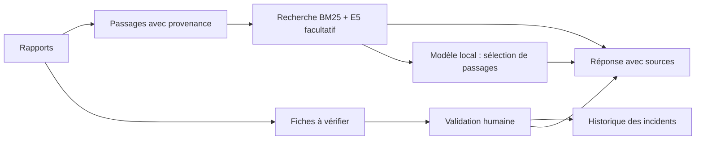

# Mémoire industrielle

**Assistant de consultation de rapports de maintenance.** Recherche hybride, modèle local et réponses sourcées.

[](https://github.com/axl-chstn/memoire-industrielle/actions/workflows/checks.yml)

[Voir la démo](docs/DEMO.md) · [Installer](docs/INSTALLATION.md) · [Résultats des tests](docs/RESULTATS.md) · [Architecture](docs/ARCHITECTURE.md) · [Présentation du projet](docs/PORTFOLIO.md) · [Ontologie](docs/ontologie/README.md)


## Le problème

Lorsqu'une panne revient, les informations utiles sont souvent dispersées entre plusieurs rapports. Il faut retrouver ce qui a été observé, ce qui a été tenté et le résultat obtenu. Une intervention enregistrée ne signifie pas forcément que la panne est résolue.

Ce projet rassemble ces informations autour des équipements et des incidents. On peut suivre un historique, consulter des cas proches et interroger les rapports en gardant accès aux passages utilisés. Il s'agit d'un prototype personnel testé sur des données fictives, pas d'un logiciel déployé chez un industriel.

## Auteur, apprentissage et modélisation

Projet initié et piloté par **Axel Chasteauneuf**, élève ingénieur à Mines Nancy : cadrage du besoin, formation au RAG, conduite du développement assisté par IA et examen des scénarios de fiabilité. Le code, les tests et la documentation ont été construits avec assistance IA.

Le projet prolonge la formation IBM SkillsBuild **Retrieval-Augmented Generation for Enhanced AI Outputs**, avec badge obtenu en octobre 2026 et première mise en pratique sur Google Colab. Le justificatif personnel est consultable sur le [profil LinkedIn](https://www.linkedin.com/in/axel-chasteauneuf-910091388/).

L’[ontologie de maintenance sous Protégé/OWL](docs/ontologie/README.md) est disponible avec son fichier, un schéma, des requêtes et les contrôles historiques. Ses concepts guident la structure des fiches ; **le fichier OWL et le raisonneur HermiT ne sont pas exécutés par l’application**. La [présentation de trois pages](docs/Memoire_industrielle_Presentation_LinkedIn_Axel_Chasteauneuf.pdf) permet de découvrir le projet sans installation.

## Un exemple en deux minutes

Dans **Atelier fictif → Incidents**, ouvrir **INC114 · P04**. Le rapport du 12 février décrit une lubrification sans résolution. Le suivi du 20 mars décrit un réalignement, avec un résultat résolu. Les deux étapes restent visibles.

Dans **Questions**, demander : **« Quelles interventions sont documentées pour INC114 ? »** Les actions, dates et résultats doivent être accompagnés de leurs sources. Puis demander **« L'incident INC117 est-il résolu ? »** : le résultat reste inconnu, car le rapport ne permet pas de conclure.

Le [parcours de démonstration](docs/DEMO.md) donne les résultats attendus et les captures de l'application. Le scénario contient **30 rapports, 10 équipements et 22 incidents**, entièrement fictifs.

## Essayer le projet

Avec **Python 3.12**, depuis le dossier du dépôt :

```bash
git clone https://github.com/axl-chstn/memoire-industrielle.git
cd memoire-industrielle
python3.12 -m scripts.bootstrap --run
```

Sur Windows, remplacer `python3.12` par `py -3.12`. L'adresse [http://127.0.0.1:8501](http://127.0.0.1:8501) ouvre l'application exécutée sur l'ordinateur. L'accès au code d'un dépôt privé nécessite un compte autorisé.

Ce premier parcours utilise les fiches et la recherche par mots-clés. Il ne télécharge aucun modèle. Pour ajouter la recherche hybride et le modèle local :

```bash
python3.12 -m scripts.bootstrap --semantic --model --run
```

L'option sémantique se coche ensuite dans **Recherche et vérification → Chercher aussi par le sens**. Le premier usage télécharge E5 ; Qwen occupe environ 2,5 Go. Le moteur Ollama est préparé automatiquement sur Mac ; sous Windows/Linux, il faut d'abord l'installer. Voir [l'installation détaillée](docs/INSTALLATION.md).

Aucune clé API ni API payante n'est utilisée. Les téléchargements initiaux demandent Internet ; le calcul utilise ensuite les ressources de l'ordinateur.

## Comment les réponses sont obtenues

| Choix | Rôle dans le projet |
|---|---|
| Python et Streamlit | Interface locale : documents, équipements, incidents et questions |
| Extraction PDF texte, TXT, Markdown | Découpage en passages, avec document et page d'origine |
| Fiches avec preuves | Incident, date, symptôme, diagnostic, intervention et résultat ; vérification humaine des imports |
| BM25 + E5 multilingue, fusion RRF | Recherche par mots-clés et, en option, par le sens ; calcul local |
| Qwen 4B via Ollama | Sélection de passages pour les questions libres, sous un format JSON contrôlé |
| SQLite | Sauvegarde locale des textes, corrections et validations |

Les questions sur les dates, les actions et les statuts reçoivent une réponse composée à partir des **fiches vérifiées**. Pour les questions libres, le modèle choisit des passages que l'application recopie avec leur référence. Il ne rédige pas de conclusion libre : ce choix a été retenu après des erreurs de chronologie et d'interprétation de données manquantes.

Le RAG est donc ici structuré et extractif. Les concepts de l'ontologie organisent les relations entre équipements, composants et incidents. Le raisonneur OWL n'est pas intégré. Les **cas similaires** utilisent des critères structurés et lexicaux ; l'option embeddings concerne l'écran **Questions**.



## Vérifications

Relevé du 17 octobre 2026 : **108 tests réussis**, recherche historique **14/14**, atelier Horizon **13/13** en BM25 et en hybride, régressions des Rives **20/20**. Les résultats et les commandes sont regroupés dans [Résultats des tests](docs/RESULTATS.md). Les tests couvrent notamment les suivis d'incidents, les dates absentes, les négations, la provenance des faits et la sauvegarde. La recherche hybride et le modèle ont aussi été vérifiés localement.

Ces essais utilisent des exemples préparés. Le corpus des Rives, corrigé après analyse de ses erreurs, est désormais un **jeu de régression connu**. Un bon résultat sur ce corpus ne mesure pas la fiabilité sur de nouveaux rapports industriels.

## Limites et données

- Les rapports sans rubriques explicites demandent des corrections manuelles. Les PDF scannés nécessitent un OCR externe.
- Une source peut être mal sélectionnée, un rapport peut être faux et une validation humaine peut comporter une erreur. Les citations permettent de vérifier la réponse, sans garantir toute son interprétation.
- Un cas similaire ne prouve pas une cause commune. L'application ne prescrit pas d'intervention et ne réalise pas de diagnostic automatique.
- Le stockage est local, sans chiffrement applicatif ni gestion des accès pour plusieurs utilisateurs. Pas de connexion GMAO ni de déploiement de production.
- L'exécution du modèle dépend de la mémoire disponible. Les versions des dépendances Python sont verrouillées ; les téléchargements des modèles et du moteur ont leurs propres versions.

Les données importées restent dans `data/private/`, exclu de Git. Les modèles et caches le sont également. Les PDF originaux sont à conserver séparément ; les questions restent dans la session. Le menu **Sauvegarde de cet espace** permet un export JSON et une restauration par ajout, sans écrasement des fiches existantes. Les exports contiennent le texte des rapports.

## Suite envisagée

La prochaine évolution envisagée est l'ajout de **rapports oraux** : transcription, brouillon modifiable, validation humaine, puis ajout aux documents consultables. Elle est décrite dans la [feuille de route](docs/ROADMAP.md) et **n'est pas implémentée**. L'évaluation de l'intérêt B2B est reportée.
