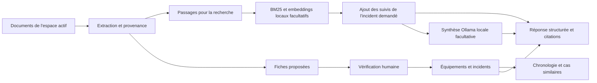

# Architecture de la V2

## Parcours

## Espaces et données

L'atelier fictif contient 30 rapports, 10 équipements et 22 incidents. Il est distinct de l'espace personnel. Chaque espace possède ses documents et ses corrections. Le registre de l'atelier et ses alias ne sont jamais appliqués aux documents personnels : une référence P01 personnelle ne devient pas automatiquement la pompe fictive P01.

Les documents sont identifiés par SHA-256, découpés en passages de 160 mots avec chevauchement de 30 mots, sans traverser les pages PDF. La limite de la maquette est de 100 documents et 100 Mo sauvegardés par espace, 10 Mo et 100 pages par PDF, avec 30 fichiers et 30 Mo par import. Les modèles publics et les journaux techniques du moteur sont conservés sous `.cache/` et `.local/`.

Les textes extraits et leurs repères de page, les corrections et leurs extraits, les validations et les retraits sont sauvegardés après chaque mutation dans SQLite, sous `data/private/espaces.sqlite3`, exclu de Git. Les PDF originaux et les questions ne sont pas stockés dans cette base. Un espace vide enregistré reste vide au redémarrage, y compris le scénario fictif. Une transaction SQLite assure l'atomicité de chaque écriture ; une révision attendue empêche un onglet périmé d'écraser les modifications d'un autre. En cas d'échec de sauvegarde, aucun message de succès n'est affiché et la version durable est rechargée si elle est lisible. Une base illisible n'est pas effacée ni remplacée automatiquement.

Les exports JSON portent un format et une version. Leur import vérifie les types, limites, identifiants, pages et preuves de chaque valeur. L'espace fictif n'accepte que les documents du scénario officiel. Une restauration fusionne seulement les documents absents, sans modifier les fiches des documents déjà présents. Toutes les fiches ajoutées sont remises à vérifier ; les validations d'un fichier importé ne font pas autorité. Le chargement direct de la base locale conserve les validations, après contrôle de leurs preuves. `MEMOIRE_DATA_DIR` permet de choisir un autre dossier local, notamment pour isoler les tests. Le dossier est créé avec des droits privés et la base avec des droits `0600` sur les systèmes qui les prennent en charge ; il n'y a pas de chiffrement applicatif ni d'authentification multiutilisateur.

## Faits et validation

Chaque fiche de rapport possède des champs : incident, équipement, date, composant, symptômes, diagnostic, statut du diagnostic, intervention, durée, résultat et constat de contrôle. Chaque valeur contient sa page et un extrait justificatif.

L'extraction reconnaît les rubriques explicites et les identifiants non ambigus. Elle ne déduit pas un diagnostic d'un symptôme. Des valeurs contradictoires d'une même rubrique ne sont pas sélectionnées arbitrairement. Les documents personnels produisent des fiches à vérifier, exclues des vues métier par défaut. Les rapports sans rubriques peuvent nécessiter une saisie manuelle sourcée.

Une correction impose que la valeur apparaisse dans l'extrait et que l'extrait soit présent sur la page sélectionnée. Elle annule la validation précédente. Une validation humaine vérifie la traçabilité des valeurs présentes ; ce contrôle informatique ne prouve pas l'interprétation métier de la personne qui valide. Une donnée absente reste absente.

Les scénarios fournis sont marqués « Scénario fictif contrôlé ». Ils servent à tester le fonctionnement et ne sont pas des données industrielles validées sur le terrain.

## Chronologie

Un incident est regroupé par sa référence et son équipement. Deux machines portant le même identifiant d'incident restent séparées. Chaque rapport conserve son état et son action, même après une résolution ultérieure.

Le dernier état provient des rapports à la date la plus récente, parmi les fiches vérifiées. Des résultats différents à la même date produisent « À clarifier ». Un rapport non daté dans une série empêche de déterminer un dernier état certain : le statut reste « Inconnu ». Aucune date d'import n'est utilisée comme date d'intervention.

Le scénario contient notamment INC114, dont une lubrification échoue avant un réalignement réussi, et INC116, dont les vibrations persistent malgré un remplacement. Une intervention ne vaut donc pas preuve de résolution.

## Recherche documentaire et réponses

BM25 fonctionne localement, avec retrait des accents, quelques mots vides français et une simplification des pluriels. Le mode hybride ajoute multilingual-e5-small, préfixes `query:` et `passage:`, vecteurs normalisés et fusion des classements RRF avec constante 60. Le seuil cosinus de 0,78 pour les résultats uniquement sémantiques est heuristique et ne garantit pas la détection d'une question sans réponse.

Les références explicites sont filtrées par catégorie : OU entre identifiants de même nature, ET entre catégories (par exemple une machine et un incident). Le moteur conserve la diversité des documents. Pour un incident explicitement demandé, les rapports de suivi vérifiés sont ajoutés, dans la limite de huit documents, afin de conserver le contexte temporel. Un rapport mentionnant un autre incident pour le distinguer n'est pas rattaché à cet autre incident.

Les réponses structurées exposent les observations, diagnostics, actions, résultats et inconnues. Une valeur n'est associée à une citation que si son extrait justificatif apparaît dans le passage cité. Les questions explicites de statut portant sur un incident utilisent les fiches vérifiées et leur chronologie, sans demander au LLM de choisir le dernier état. Un contexte incomplet ou des fiches non vérifiées empêchent de conclure sur ce statut.

Pour les autres questions, Ollama peut produire une synthèse courte à partir des passages. Le contrôle exige des identifiants de citation valides et rejette une confusion directe entre inconnu et non résolu dans les formulations couvertes. Cela ne prouve pas la fidélité de chaque phrase du LLM. Les faits structurés restent présentés avec leurs preuves en complément.

## Cas similaires et ontologie

Le rapprochement utilise les symptômes, catégories de composants, types d'équipement et termes de description. Un petit vocabulaire rapproche par exemple « chauffe » et « surchauffe ». Le classement expose les critères communs et ne représente pas une probabilité de cause commune. Les étapes infructueuses et le résultat documenté restent consultables.

Les concepts du TD guident ces relations : équipement → composant, incident → équipement, rapport → incident, intervention → résultat, et symptôme distinct du diagnostic. Le registre fictif définit la composition et les appellations des machines. Cette V2 n'exécute pas le raisonneur OWL et ne prétend pas réaliser toutes les inférences de Protégé. La recherche de cas similaires est une fonction structurée ; le mode embeddings facultatif concerne l'écran Questions.

## Modèle et absence de frais d'API

Le modèle reste qwen3:4b-instruct, exécuté par Ollama sur 127.0.0.1:11435, avec `OLLAMA_NO_CLOUD=1`. L'application n'utilise aucune clé, fournisseur distant, proxy HTTP ou redirection. Les poids GGUF locaux sont vérifiés avant la transmission des passages. Il n'existe pas de basculement payant.

Le contexte est de 4096 tokens et la sortie limitée à 700 tokens. Une réponse signalée comme tronquée est refusée. De très longs extraits ou de nombreuses sources peuvent dépasser cette fenêtre ; la qualité du modèle doit être évaluée séparément sur des documents réels. Les contenus des documents sont des données non fiables et non des instructions ; le prompt n'est toutefois pas une isolation parfaite contre les injections.

## Code

| Fichier | Rôle |
|---|---|
| `app.py` | Espaces, navigation et parcours de questions |
| `memoire/views.py` | Équipements, incidents, bibliothèque, corrections et cas similaires |
| `memoire/knowledge.py` | Faits, provenance, validation et chronologie |
| `memoire/storage.py` | SQLite, révisions, validation JSON et fusion des sauvegardes |
| `memoire/workspace_ui.py` | Export et restauration de l'espace actif |
| `memoire/qa.py` | Alias et sélection des rapports de suivi |
| `memoire/documents.py` | Extraction et découpage |
| `memoire/retrieval.py` | BM25 et embeddings |
| `memoire/answers.py` | Réponses structurées, statuts documentés et synthèse |
| `memoire/local_llm.py` | Transport exclusivement local |
| `scripts/build_workshop.py` | Génération reproductible de l'atelier fictif |
| `scripts/evaluate_workshop.py` | Évaluation des sources et statuts documentés de la V2 |
