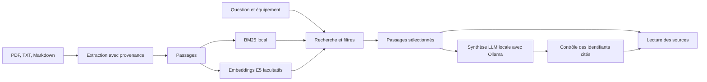

# Architecture de la maquette

## Parcours des données

## Choix

Python et Streamlit permettent une petite application sans séparer serveur et interface. Une base vectorielle externe n'est pas nécessaire à cette échelle : les vecteurs normalisés sont comparés dans NumPy. Le projet est volontairement limité à 50 documents en mémoire.

Les documents sont identifiés par le SHA-256 de leur contenu pour éviter les doublons. Chaque passage garde le nom du fichier, son document d'origine, sa page PDF et son numéro de passage. Les fichiers texte n'ont pas de pagination artificielle.

Le découpage utilise 160 mots et 30 mots de chevauchement, sans traverser les pages PDF. Ce réglage est un point de départ ; une segmentation par structure et un contrôle du nombre de tokens seraient utiles sur des documents longs ou spécialisés. Le modèle peut tronquer une entrée dépassant sa fenêtre.

Le mode de base calcule BM25 avec retrait des accents, quelques mots vides français et une simplification des pluriels. Le mode hybride ajoute E5 : préfixe `passage: ` pour les documents et `query: ` pour les questions ; vecteurs normalisés. Les classements sont fusionnés par Reciprocal Rank Fusion (constante 60). Les résultats purement sémantiques doivent dépasser 0,78 de cosinus. Ce seuil est heuristique et doit être évalué sur un corpus réel : il ne garantit pas la détection des questions sans réponse.

Une référence explicite comme `P01`, `C01_RA` ou `INC07` restreint les résultats. Plusieurs références sont combinées par ET. Ce choix conservateur empêche de substituer un incident voisin, mais peut écarter une question de comparaison entre deux documents distincts. Pour ces comparaisons, retirer les références de la question et utiliser un filtre plus large, ou faire deux recherches.

Le LLM est local et facultatif, sans outils ni accès au reste du corpus. Le moteur Ollama dédié écoute sur 127.0.0.1:11435, avec les fonctions cloud désactivées au démarrage. Le transport HTTP ne consulte aucune configuration de fournisseur, clé ou proxy et refuse les redirections. Les métadonnées du modèle fixé `qwen3:4b-instruct` sont vérifiées avant de transmettre les extraits : poids GGUF présents, informations du modèle disponibles et aucune origine distante déclarée. Il n'existe pas de basculement vers une API payante.

Le modèle génère avec température 0, contexte de 4096 tokens et limite de 700 tokens de sortie, sur un seul traitement à la fois. Une sortie signalée comme tronquée est refusée. Le contexte de départ de la maquette est petit ; de longs extraits, des langues peu compactes ou des questions très longues peuvent encore dépasser cette fenêtre. Le lanceur conserve les poids publics sous `.cache/ollama-models` et le moteur sous `.local/ollama` ; ces dossiers sont exclus de Git.

La question et les sources sont sérialisées dans un objet JSON ; les règles de réponse sont séparées dans le message système. Un texte contenant des consignes malveillantes reste toutefois un risque résiduel d'injection : le prompt ne constitue pas une isolation parfaite.

Le validateur exige au moins une référence `[Sn]` et rejette les identifiants inexistants. Une synthèse sans références valides est remplacée par les extraits. Il ne vérifie pas l'appui de chaque affirmation : cette vérification nécessite une évaluation dédiée. Le texte généré est affiché comme texte, et les sources comme blocs de code pour éviter de charger des liens ou images fournis par les documents.

Un garde-fou supplémentaire concerne les questions de résolution lorsque tous les extraits contiennent explicitement « issue non renseignée » ou « aucune conclusion de résolution ou de non-résolution ». Une déclaration directe de résolution ou de non-résolution dans la synthèse est alors écartée au profit des extraits. Ce contrôle est ciblé, conservateur et fondé sur quelques formulations ; il ne valide pas toutes les formulations possibles ni la fidélité globale d'une réponse.

## Répartition du code

| Fichier | Rôle |
|---|---|
| `app.py` | Interface, import, session et parcours utilisateur |
| `memoire/documents.py` | Extraction, références, découpage et provenance |
| `memoire/retrieval.py` | BM25, embeddings et fusion des classements |
| `memoire/answers.py` | Contexte RAG, synthèse locale et contrôle des références |
| `memoire/local_llm.py` | Transport HTTP exclusivement local et contrôle des poids |
| `scripts/local_runtime.py` | Installation, démarrage local et téléchargement initial |
| `memoire/demo.py` | Chargement du corpus fictif |
| `scripts/evaluate.py` | Évaluation des passages retrouvés |

L'ontologie du TD n'est pas exécutée ici. Elle guide le vocabulaire du projet ; son intégration devra être comparée à ce RAG de référence, sur les mêmes questions.
