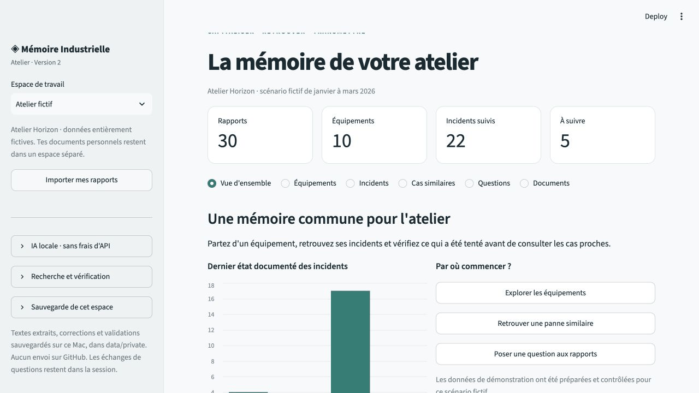
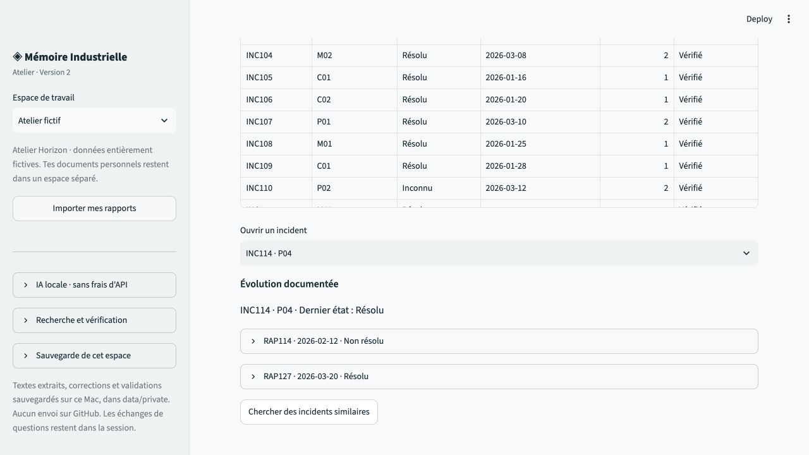
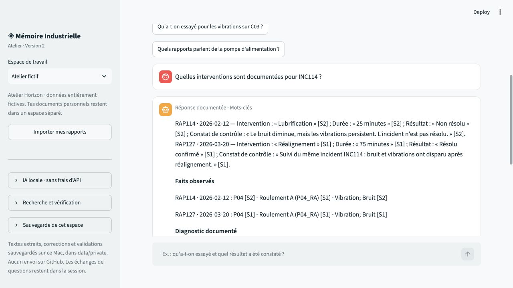
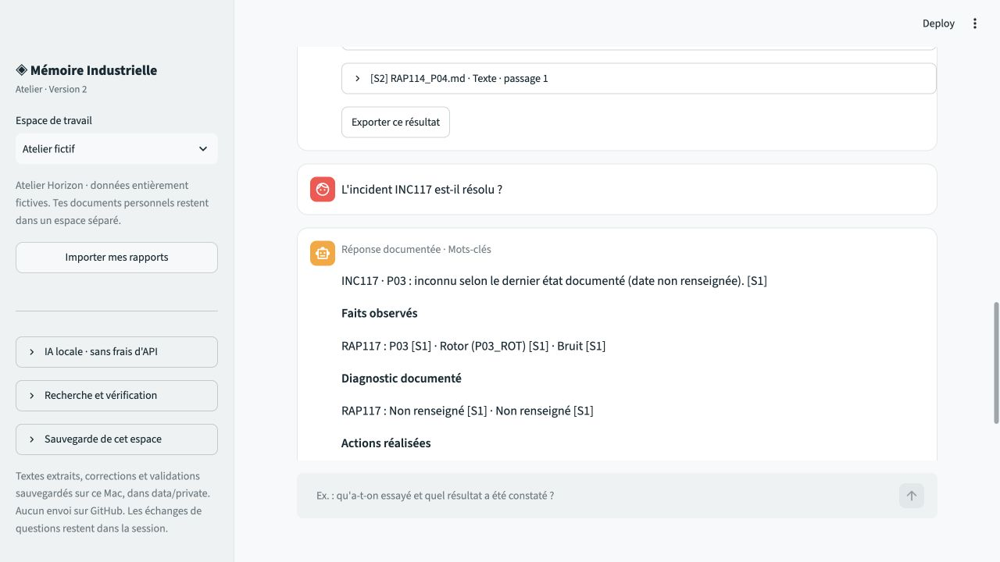

# Démonstration · retrouver ce qui a été tenté

**Durée : environ 2 minutes.** Utiliser l'espace **Atelier fictif**. Aucun document personnel n'est nécessaire. Le parcours principal fonctionne sans modèle ; les options hybrides et LLM se présentent ensuite séparément.

## Aperçu en 27 secondes

Diaporama de quatre captures réelles, sans audio. Le scénario à reproduire et les points à expliquer suivent ci-dessous.

## 0:00 — Le contexte

« Une pompe vibre à nouveau. Avant de chercher une nouvelle intervention, je veux retrouver les actions déjà réalisées et leurs résultats. »

Montrer les 30 rapports, 10 équipements et 22 incidents de l'atelier fictif.

## 0:20 — Garder les deux étapes de l'incident

Dans **Incidents**, ouvrir **INC114 · P04** et les rapports RAP114 et RAP127.

| Date | Action documentée | Durée | Résultat |
|---|---|---|---|
| 12 février 2026 | Lubrification du palier | 25 min | Non résolu |
| 20 mars 2026 | Réalignement | 75 min | Résolu |

Montrer que la résolution ultérieure ne masque pas la première tentative. Les durées sont celles des interventions décrites, pas un temps d'arrêt calculé.

## 0:50 — Poser une question et vérifier les sources

Dans **Questions**, saisir : **« Quelles interventions sont documentées pour INC114 ? »**

Vérifier que les deux actions et leurs résultats restent distincts. Ouvrir les sources de RAP114 et RAP127 pour revenir aux textes. La réponse est composée depuis les faits vérifiés ; elle n'exige pas une conclusion rédigée par le LLM.

## 1:25 — Montrer une limite utile

Demander : **« L'incident INC117 est-il résolu ? »**

Le résultat attendu est **inconnu**. L'absence de résultat documenté ne devient ni une résolution ni un échec certain. Le rapport non daté ne reçoit pas une date inventée.

## 1:50 — Expliquer le rôle de l'IA

« BM25 retrouve les mots et les références. L'option E5 ajoute la recherche par le sens, avec une fusion des classements. Pour les questions libres, Qwen tourne sur l'ordinateur et sélectionne des passages ; l'application affiche ces textes avec leur source. J'ai limité sa liberté de rédaction après avoir constaté des erreurs sur la chronologie et les informations absentes. »

Si les options sont installées, cocher **Chercher aussi par le sens**, puis poser **« Quels passages décrivent INC116 ? »**. Le libellé du mode de recherche et celui de sélection locale permettent de voir le chemin réellement utilisé. Ne pas présenter le parcours principal comme une preuve que le LLM a généré les réponses.

## Ce que cette démonstration prouve

Le projet permet de naviguer dans un corpus fictif, de conserver les suivis, de consulter des réponses avec sources et de laisser une information inconnue. Il ne prouve ni la qualité sur des rapports industriels indépendants, ni un gain de temps métier, ni un diagnostic automatique.
