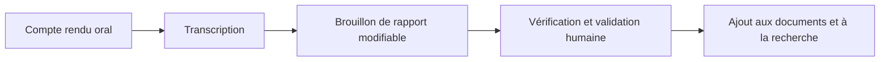

# Suite du projet

## État actuel

Le projet est un assistant local de consultation de rapports : import de documents, validation humaine, fiches d'équipements, suivis d'incidents, recherche hybride facultative et réponses sourcées. La démonstration, l'installation verrouillée et les résultats de tests permettent de le présenter comme projet personnel sur un CV.

Les essais reposent sur des corpus fictifs. Le raisonneur OWL, l'OCR, la reconnaissance vocale, la connexion GMAO et l'usage partagé ne sont pas implémentés.

## Prochaine évolution envisagée : les rapports oraux

L'idée est de faciliter l'ajout d'informations après une intervention, en permettant au technicien de raconter ce qu'il a observé et réalisé.

Un premier périmètre pourrait accepter un fichier audio, produire sa transcription puis proposer les rubriques déjà utilisées par l'application : équipement, incident, date, observation, diagnostic éventuel, action et résultat. Les champs absents resteraient inconnus. Le technicien corrigerait et validerait le rapport avant son ajout aux vues métier.

La provenance devrait relier les informations au texte transcrit et, si possible, à un repère temporel dans l'audio. Il faudrait distinguer la date annoncée de l'intervention, la date d'enregistrement et la date d'import. Les négations, références machines, bruits d'atelier et diagnostics seulement supposés seraient des cas d'essai prioritaires.

**Cette chaîne est une piste future. Aucun enregistrement, stockage audio, moteur de transcription ou extraction depuis la voix n'a été ajouté à cette version.** Le choix du moteur et son fonctionnement local restent à étudier en conservant l'objectif d'absence de frais d'API.

## Évaluation B2B reportée

Aucun travail de validation commerciale n'est engagé à cette étape. Pour une reprise ultérieure, le [protocole](VALIDATION.md) propose de partir de rapports autorisés et de questions écrites avant le réglage du moteur. Il faudra évaluer la tâche réelle avec des utilisateurs, puis traiter les exigences d'accès, de confidentialité et d'intégration propres au contexte retenu.
