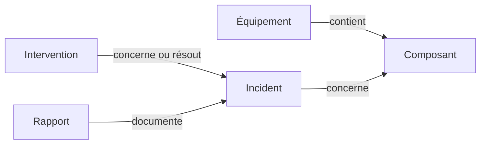

# Ontologie de maintenance industrielle

Cette brique pédagogique complète le prototype documentaire porté par **Axel Chasteauneuf**. Elle modélise les équipements, composants, incidents, interventions et rapports avec OWL 2 DL. Sa base a été construite avec assistance IA dans le cadre du travail pédagogique sur la maintenance ; elle ne constitue pas une revendication de développement individuel exclusif.

## Ouvrir et explorer

1. Ouvrir [maintenance_industrielle.owl](maintenance_industrielle.owl) dans Protégé.
2. Sélectionner HermiT et démarrer le raisonneur.
3. Utiliser le [guide des requêtes et inférences](guide_Protege.md).

Le fichier OWL est autonome, sans imports distants. Les rapports et instances sont entièrement fictifs. Les autres documents du dossier sont des copies des livrables pédagogiques d’origine.

## Schéma de lecture

Il s’agit d’un schéma simplifié de relations métier, et non de la hiérarchie complète des classes.

## Exemple vérifiable

L’incident **INC10** concerne un roulement du sous-ensemble d’une pompe P02. Grâce à la composition et aux relations inverses, la requête **Q11** retrouve le roulement, le palier et la pompe comme objets affectés. Une date ou une résolution absente ne permet pas d’inférer une non-résolution. Voir les [données et cas](modele_et_donnees.json), les [rapports fictifs](rapports_fictifs.md) et le [relevé de vérification](verification.json).

Le relevé conservé comporte **39 classes, 103 individus et 36 contrôles réussis avec HermiT**, dont 12 requêtes. Ces contrôles sont historiques : ils n’ont pas été réexécutés lors de la préparation du portfolio LinkedIn. Ils vérifient la logique du périmètre pédagogique, pas un diagnostic industriel.

## Lien avec l’application RAG

Les concepts de l’ontologie guident l’organisation des fiches : équipement, composant, incident, intervention et résultat documenté. **L’application ne charge pas le fichier OWL et n’exécute pas HermiT.** La base OWL et les jeux de démonstration de l’application sont distincts ; il n’existe pas de synchronisation automatique entre leurs identifiants.

Une intégration future devrait relier explicitement les entités des rapports aux objets de l’ontologie et mesurer son apport sur des questions nouvelles. L’ontologie actuelle ne doit donc pas être présentée comme un moteur GraphRAG intégré.
